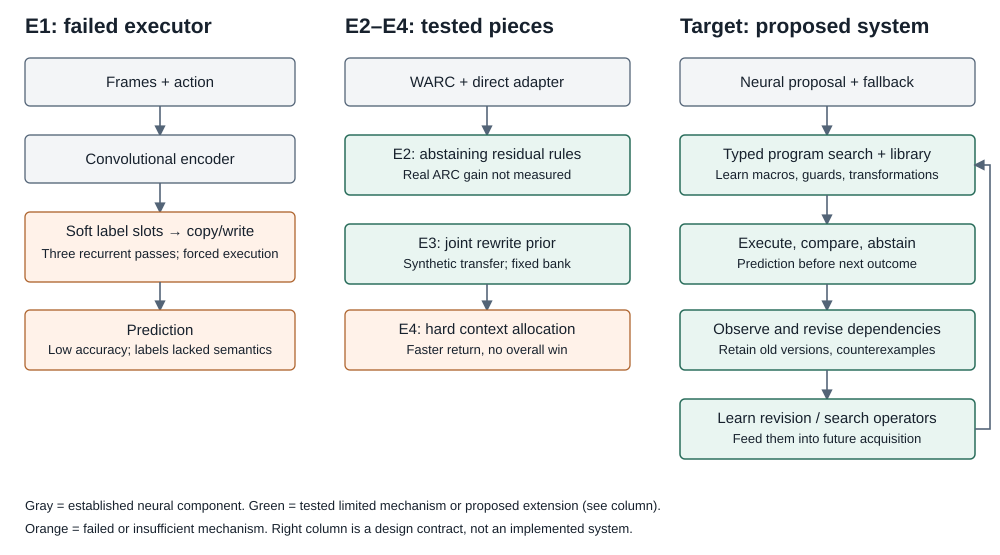

# Recursive acquisition of executable knowledge

**Canonical branch: master. Read [architecture contract](ARCHITECTURE.md), [E16](experiment_16_event_composition.ipynb), and [E17 real trace](E17_REAL_TRACE.md).** CPU research only; no SOTA claim and no candidate GPU scaling yet.

## Current research ledger

| Experiment | Decision |
|---|---|
| [E1–E4](experiment_ledger_v4.ipynb) | Failed executor and shift tests; preserve original outputs |
| [E5–E6](experiment_05_06.ipynb) | Shared revision / program reuse work in controlled tasks, negative transfer |
| [E7](experiment_07_semantic.ipynb) | Overlapping behavioral classes, no uniform win |
| [E8–E9](experiment_08_09_relations.ipynb) | Joint inference works when structured; semantic querying loses |
| E10–E12 | Interrupted local work, not published or independently verified |
| [E13](experiment_13_bidirectional.ipynb) | Bidirectional inference; frozen gate fails |
| [E14](experiment_14_residual.ipynb) | Coarse baseline wins; frozen gate fails |
| [E15](E15_REAL_TRACE.md) | Real cached WARC trace; zero gain |
| [E16](experiment_16_event_composition.ipynb) | Toy gate passes; joint Bayesian inference over supplied language |
| [E17](E17_REAL_TRACE.md) | Whole-event primitive ties teacher on reused development trace; role proposal coverage zero |

Future test: event-relative participant relations, whole temporal events and learned schema discovery, with neural fallback and pretraining. Strongest conventional joint inference/library-learning comparators; independent real data before scale. See E17 for benchmark sources and data gate.

<details><summary>Historical README through E6 (preserved)</summary>

# Recursive acquisition of executable knowledge
**Canonical branch: `master`. Start with [experiment_05_06.ipynb](experiment_05_06.ipynb), then [research_state.ipynb](research_state.ipynb) for the historical architecture and [experiment_04_stress.ipynb](experiment_04_stress.ipynb) for the previous negative result.** CPU only for current work. All notebooks and original saved Kaggle outputs are in this directory. Do not rerun archived GPU cells blindly.



## Notebook index
| Notebook | Purpose |
|---|---|
| [experiment_05_06.ipynb](experiment_05_06.ipynb) | Latest: executed CPU toys — scoped theory revision and compositional library acquisition; E7 specification |
| [research_state.ipynb](research_state.ipynb) | Architecture and decisions through E4; historical record |
| [experiment_ledger_v4.ipynb](experiment_ledger_v4.ipynb) | Cumulative ledger through E4, original saved GPU outputs, CPU code and optional neural replay |
| [experiment_04_stress.ipynb](experiment_04_stress.ipynb) | NEW: executed stress audit with irregular shifts and partial feedback |
| [experiment_04.ipynb](experiment_04.ipynb) | E4 standalone CPU reproduction |
| [experiment_ledger_v3.ipynb](experiment_ledger_v3.ipynb) | E3 rewrite and composition prior experiments |
| [experiment_ledger_v2.ipynb](experiment_ledger_v2.ipynb) | E2 abstaining rule corrections, original output archive |
| [experiment_01_kaggle.ipynb](experiment_01_kaggle.ipynb) | Original executed Kaggle notebook, unmodified archive |
| [colab.ipynb](colab.ipynb) | Original GPU runner (historical, known bugs in pinned source) |
| [recursive_world.py](recursive_world.py) | Original E1 implementation (historical; not recommended) |

## Latest decision (E5–E6)
E5: learning a global-versus-local edit prior transfers across two supplied predicate vocabularies when scope frequency matches; it hurts under reversed frequency and two simultaneous edits outside the model. E6: actual AST enumeration acquires named programs and reuses them to synthesize deeper programs; a library-only search fails on an unrelated task. An exploratory bounded library/flat fallback solves 5/5 vs 2/5 for flat search on two fresh permutations of the same engineered curriculum. Neither is novel or SOTA; both use finite synthetic domains. See the notebook for exact controls, CPU measurements, limitations and the E7 test of versioned dependency revision and learned executable theory edits.

## Previous decision (E4)
E3 joint prior beats factorized prior on controlled correlated tasks, fails under shift. E4 hard context reuse improves return to old regimes but not overall accuracy. Stress audit: context minus change-point = −0.36, −0.18, +0.03 pp for 1,4,81 feedback examples on irregular shifts; all intervals include zero. Random four-feedback gap −1.70 pp. Stop tuning hard allocation. **No current SOTA claim.**

## Next serious experiment (E7; see notebook for precise gate)
1. Build typed AST enumeration and discover reusable parameterized subprograms rather than rank a fixed bank. Compare flat enumeration, frequency/search priors, retrieval, and DreamCoder/Stitch-style library compression. Use equal candidate execution and wall-time budgets; account for library construction and meta-training cost. Hold out compositions and longer programs, use two independent task generators and noisy/out-of-library controls.
2. Introduce explicit versioned dependencies and learned revision operators. Test delayed contradictions and counterexample-driven generalization separately from context selection. Freeze seeds and criteria before evaluation; report search attempts, accuracy by exposure, and paired stream intervals.
3. Reuse pretrained WARC and the actual full TTT baseline on held-out recordings. Keep strong neural fallback, use only observed transitions for adaptation; compare simple retrieval/keep/consensus controls, report errors corrected and introduced, full compute and exact accuracy. No GPU until CPU gates pass.
4. For a public SOTA claim, use an official available benchmark with matched protocol, exact evaluator and splits, full comparator reruns, uncertainty and compute. WARC's MechEval 69.1% is per-mechanic, not our replay metric. If official labels/scorer are unavailable, use a reproducible official ARC benchmark or make only a narrower claim against WARC on the declared replay proxy. Closed-loop ARC-AGI-3 requires the same agent/explorer and official action-efficiency evaluator. A world-model result is not an agent leaderboard result. Verify the current best published methods before any claim.

### Relevant sources
[WARC paper](https://arxiv.org/abs/2611.12324) · [WARC code](https://github.com/third-intelligence/WARC) · [DreamCoder](https://arxiv.org/abs/2006.08381) · [Stitch / Top-Down Synthesis for Library Learning](https://arxiv.org/abs/2211.16605) · [Stitch code](https://github.com/mlb2251/stitch) · [CodeARC](https://arxiv.org/abs/2503.23145) (candidate separate program-synthesis benchmark; protocol must be checked) · [BOCPD](https://arxiv.org/abs/0710.3742).
 
<details><summary>Original E1 README (historical; superseded)</summary>

# Recursive guarded world model

Hypothesis: a discovered operation should be executable independently of its applicability, and later discoveries should change the interpretation of earlier observations.

The model is a recurrent convolutional executor, not a Transformer. Its initial copy/write vocabulary is supplied; the label dictionary, guards and conditional composition are learned. The active dictionary starts at four slots, splits high-error labels, and has a reserve of twelve. The same operations execute across three passes; label fields feed subsequent passes. Old training transitions get reassigned using the current dictionary. These are bounded, local experiments, not general program induction.

## Start here — current experiment

[Open the staged GPU notebook in Colab](https://colab.research.google.com/github/shekhawatxyz/fastai-2022/blob/research/recursive-world-model/experiments/recursive_world/colab.ipynb). The same notebook runs on Kaggle with Internet enabled.

The notebook includes architecture diagrams, predictions before each run, a smoke test, a 24-exposure integration pilot, and a larger three-seed public-game sweep. New transfer arms reuse frozen held-out WARC predictions as features and learn a gated mixture with the new executor. Compare transfer_grow against transfer_direct, transfer_stale, transfer_small, transfer_fixed, and actual WARC TTT. The gate begins near the pretrained prediction. Frozen prior computation is cached and its cost logged separately. The released replay rotation multiplicities are matched. This is a public-replay proxy, not official MechEval. GPU execution and benchmark superiority remain unverified.

## Run

Open `colab.ipynb` in Google Colab and select a GPU (A100/L4 preferable; T4 supported in FP32). Or use:

```bash
git clone --depth 1 --branch research/recursive-world-model https://github.com/shekhawatxyz/fastai-2022
cd fastai-2022/experiments/recursive_world
python recursive_world.py --suite smoke --epochs 4 --seeds 1 --profile
python recursive_world.py --suite synthetic --epochs 12 --seeds 3 --ensemble --profile
```

For actual ARC human trajectories, use the released WARC implementation:

```bash
git clone https://github.com/third-intelligence/WARC /content/WARC
git -C /content/WARC checkout f0081ef00e867f63a08b1e4e7350d2baa0440267
pip install datasets einops timm huggingface_hub arc-agi==0.9.9 arcengine==0.9.3
python recursive_world.py --suite arc --games ls20 --sessions 1 --limit 24 --seeds 1 --arms direct,copy,small,stale,grow --profile --hard-arc --out arc_pilot
```

The default dataset is the public human-recordings mirror on Hugging Face. Alternatively extract the official ARC Prize Public Demo dataset and pass `--data /path/to/extracted`. Mirror byte identity has not been verified. The first qualifying recordings are selected deterministically, not by scores. Increase games, sessions, limit and seeds only after the pilot runs. Use held-out games for final conclusions, not hyperparameter tuning.

## Controls

| Arm | Purpose |
|---|---|
| direct | Direct color prediction |
| copy | Direct primitive selection, no learned dictionary |
| static | Same repeated neural computation, no intermediate execution/label feedback |
| recursive | Fixed 12-slot dictionary, recursive executor, no explicit retrospective target |
| fixed | 12-slot dictionary with retrospective relabeling |
| small | Four active slots, retrospective relabeling, no births |
| stale | Growing dictionary, initial pseudo-labels kept |
| grow | Growing dictionary plus retrospective relabeling |

All local models use the same width, recurrent passes, optimizer and input data (their heads have different parameter counts). Real replay uses three-frame context, 10 recent + 20 older transitions, official rotation transformations, 20 updates per observation by default, minibatch up to eight, gradient clipping, AdamW. WARC runs its released Muon/AdamW recipe. WARC frozen, pretrained TTT, and randomly initialized WARC TTT are separate comparisons. They differ in parameter count and pretraining; identical observations do not mean identical compute. Scratch WARC is the nearest pretraining control. BF16 is used where supported; unsupported GPUs run FP32, explicitly differing from published precision.

Optional ensembles average independently seeded predictions at additional cost; compare single models first. Hard execution is a separate score, not silently substituted for soft training.

## Outputs

- scores.csv: prequential changed-cell accuracy, false edits, exact frames, change F1, timing.
- epochs.csv: loss, gradient norm, active labels, cumulative update count, mean revision distance.
- weight_drift.csv: per-parameter distance from initialization, RMS update and cosine similarity.
- vocabulary.csv: active slots, primitive selection, confidence, entropy.
- births.csv: parent/child label events.
- paired_changed_accuracy.csv: recording-matched differences on ARC.
- trace.json / profile.txt: PyTorch CPU/CUDA profiler, a separate warmed-up update on the actual frame size.

## Falsification

The official MechEval scorer/annotations are not released. The published reference values in the script are **not comparable** to this all-changed-cell replay proxy. Evaluate frozen and TTT WARC on the same replay to make a valid comparison. No claim of novelty or benchmark superiority is made. To support the recursive mechanism, grow must beat stale, small and fixed, while controlling data, update count, exact-frame accuracy, false edits and wall time. If a direct copy baseline wins, reject the added machinery. If only the ensemble wins, attribute the gain to extra compute until proven otherwise. Synthetic experiments favor a supplied copy DSL; do not confuse them with independent evidence.

Development note: the preceding fixed-slot prototype was CPU-smoke-tested; the expanded code and full upstream integration still require execution in Colab. The script starts with assertions to detect obvious causal leakage, invalid hard execution, failed parameter updates and label growth errors.


</details>


</details>
